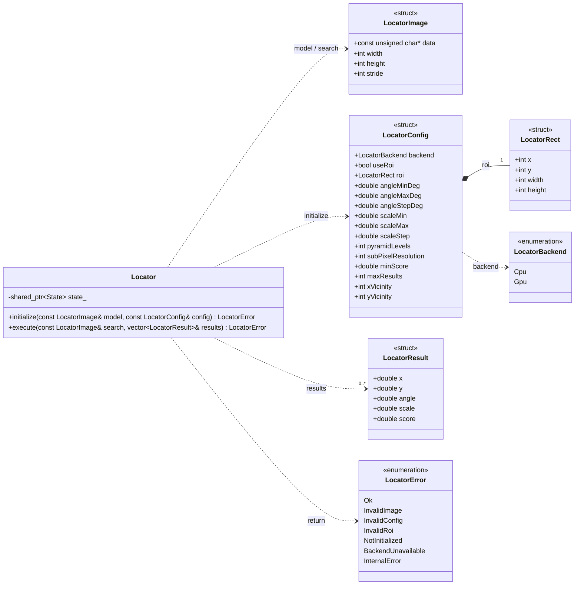
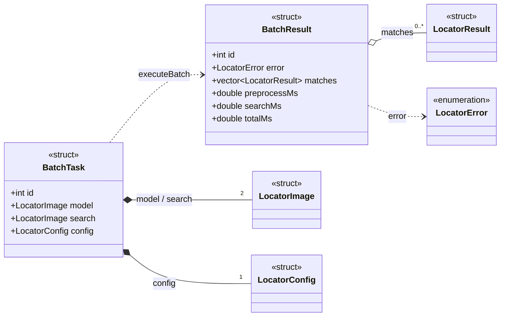

# Locator API 调用手册

　　本手册说明如何把搜索匹配源码接入 C++ 工程。初次使用可直接查看第 2 章，按“准备图像、填写参数、初始化、执行、读取结果”的顺序完成调用。后续章节解释数据结构、全部参数、错误码和文件辅助接口。

　　核心库只处理 8 位单通道灰度图。公共类型和函数位于全局命名空间，以 `include/Locator.h`、`include/BatchLocator.h` 和 `tools/BatchData.h` 中的声明为准。`src/` 下的算法函数和 `mfc/` 下的工作流属于内部实现，不作为集成接口。

## 1. 调用方式与接口范围

　　本库把搜索参数集中在 `LocatorConfig` 中，不提供逐项 Set 函数。单图调用使用一个 `Locator` 对象，批量调用把图像和参数装进 `BatchTask`，再交给 `executeBatch`。

### 1.1 公共接口 UML 类图

　　核心定位类图对应 `include/Locator.h`，展示定位器、图像视图、配置、结果和枚举之间的代码关系。



　　批量接口类图对应 `include/BatchLocator.h`。其中复用的核心类型只保留类名，完整字段见上一张图。



　　实心菱形表示结构体按值持有字段，空心菱形表示批量结果包含匹配数组，虚线表示参数、返回值或调用依赖。`executeBatch` 是自由函数，图中用 `BatchTask` 到 `BatchResult` 的依赖表示，不存在同名 C++ 类。`Locator::execute` 的实际声明带 `const` 限定，完整签名见第 4.2 节。

### 1.2 公共接口

| 需求 | 头文件 | 公共接口 |
| --- | --- | --- |
| 预处理模板 | `Locator.h` | `Locator::initialize` |
| 搜索一幅图像 | `Locator.h` | `Locator::execute` |
| 并行执行一组任务 | `BatchLocator.h` | `executeBatch` |
| 读取灰度图片 | `tools/BatchData.h` | `loadGrayImage` |
| 配对 Thick 图像 | `tools/BatchData.h` | `findThickPairs` |
| 构造循环复用的批量任务 | `tools/BatchData.h` | `makeBenchmarkTasks` |

　　`BatchLocator.h` 已包含 `Locator.h`。只有使用图片读取或 Thick 数据配对时，才需要包含 `tools/BatchData.h` 并链接 OpenCV 图像编解码库。

## 2. 快速上手

　　本章的 `model` 表示模板图，`search` 表示一幅搜索图。它们都是 `LocatorImage`，保存像素地址、宽、高和行跨度。第 3.1 节说明如何填写图像视图，第 7.1 节给出从文件读取图片的用例。

　　本章提供三个独立的全链路 `.cpp` 示例。每个文件都包含 `main`、内存图生成、参数配置、对象或任务构造、实际调用、错误检查和结果输出，源码内按步骤添加了注释。三个文件不依赖外部图片。

| 调用模式 | 完整源码 | 构建说明 |
| --- | --- | --- |
| 单图搜索 | [MinimalExample.cpp](../examples/MinimalExample.cpp) | 现有 `LocatorExample` 工程可直接构建 |
| 批量图像搜索 | [BatchExample.cpp](../examples/BatchExample.cpp) | 在核心源文件之外额外加入 `src/BatchLocator.cpp` |
| 多模板常驻 OpenMP | [OpenMPLoopExample.cpp](../examples/OpenMPLoopExample.cpp) | 建模与实时循环分离。未启用 OpenMP 时按串行执行 |

　　三个文件应分别构建为可执行程序，不要同时加入同一个工程。下面的代码用于说明对应模式的核心调用步骤，完整输入准备和输出代码以链接文件为准。

### 2.1 单图搜索匹配

　　先明确本例涉及的公共类型。这里只说明它们在调用流程中的职责，完整字段和取值约束可在对应章节查阅。

| 类型 | 在调用流程中的作用 | 详细说明 |
| --- | --- | --- |
| `LocatorImage` | 描述模板图和搜索图的像素地址、宽、高及行跨度 | 第 3.1 节 |
| `LocatorConfig` | 保存搜索后端、角度、尺度、阈值和结果数量等参数 | 第 3.3 节 |
| `LocatorResult` | 保存匹配中心的 x、y 坐标，以及角度、尺度和分数 | 第 3.4 节 |
| `LocatorError` | 表示初始化或搜索是否成功，失败时给出具体错误码 | 第 6.2 节 |

　　下面的 `locateOne` 把配置、构造、初始化、搜索、结果读取和返回放在同一个函数中。图像由调用方传入，匹配结果通过 `results` 带回调用方。

```cpp
#include "Locator.h"
#include <vector>

LocatorError locateOne(const LocatorImage& model, const LocatorImage& search,
                       std::vector<LocatorResult>& results)
{
    // 步骤 1：声明并填写配置，只返回一个至少 80 分的结果。
    LocatorConfig config;
    config.minScore = 80.0;
    config.maxResults = 1;

    // 步骤 2：构造定位器，使用模板和配置完成初始化。
    Locator locator;
    LocatorError error = locator.initialize(model, config);
    if (error != LocatorError::Ok) {
        return error;
    }

    // 步骤 3：同步执行搜索。函数返回前会清空并重新填写 results。
    error = locator.execute(search, results);
    if (error != LocatorError::Ok) {
        return error;
    }

    // 步骤 4：读取最佳结果。空数组表示没有满足条件的结果。
    if (!results.empty()) {
        const LocatorResult& best = results[0];
        // 在这里使用 best.x、best.y、best.angle、best.scale 和 best.score。
    }
    return LocatorError::Ok;
}
```

　　`execute` 返回 `LocatorError::Ok` 后才能读取 `results`。`locateOne` 向调用方返回错误码时，调用方不得使用匹配数据。返回 `Ok` 且数组为空时，表示搜索正常完成，但没有达到阈值的结果。

### 2.2 批量图像搜索

　　每个 `BatchTask` 保存一对图像、一套参数和一个任务编号。`executeBatch` 同步返回 `std::vector<BatchResult>`，结果顺序与输入任务顺序一致。下例的 `pairs` 中，`first` 是模板，`second` 是搜索图。

```cpp
#include "BatchLocator.h"
#include <utility>
#include <vector>

std::vector<BatchResult> locateBatch(
    const std::vector<std::pair<LocatorImage, LocatorImage> >& pairs,
    int threadCount)
{
    // 步骤 1：设置本批任务共用的基础参数，各任务也可以单独配置。
    LocatorConfig config;
    config.minScore = 80.0;
    config.maxResults = 1;

    // 步骤 2：逐对图像构造任务，任务编号用于核对输入与结果。
    std::vector<BatchTask> tasks;
    tasks.reserve(pairs.size());
    for (size_t i = 0; i < pairs.size(); ++i) {
        BatchTask task = {};
        task.id = static_cast<int>(i);
        task.model = pairs[i].first;
        task.search = pairs[i].second;
        task.config = config;
        tasks.push_back(task);
    }

    // 步骤 3：同步执行批量搜索，threadCount 为工作线程数。
    const std::vector<BatchResult> results = executeBatch(tasks, threadCount);

    // 步骤 4：逐任务检查错误码，再读取该任务的匹配数组。
    for (const BatchResult& result : results) {
        if (result.error != LocatorError::Ok) {
            continue;  // 当前任务失败不影响其他任务，可按 result.id 记录错误。
        }
        if (!result.matches.empty()) {
            const LocatorResult& best = result.matches[0];
            // 在这里使用 best.x、best.y、best.angle、best.scale 和 best.score。
        }
    }
    return results;
}
```

　　全部图像及底层像素必须保持有效且内容不变，直到 `executeBatch` 返回。`BatchResult` 还包含预处理、搜索和整体耗时，字段含义见第 3.5 节。

### 2.3 多模板常驻搜索与外部 OpenMP

　　500～600 个定位核连续检测时，每个定位核使用一个常驻 `Locator`。建模阶段分别初始化模板、ROI 和配置，实时阶段只更换搜索图并调用 `execute`。OpenMP 为可选能力，需要在 Visual Studio 的“C/C++ → 语言 → OpenMP 支持”中选择“是”。

```cpp
#include "Locator.h"
#include <vector>

// models、searches 和 configs 是按相同下标一一对应的输入数组。
const int taskCount = static_cast<int>(models.size());
std::vector<Locator> locators(taskCount);
std::vector<LocatorError> errors(taskCount);
std::vector<std::vector<LocatorResult> > allResults(taskCount);

// 步骤 1：建模阶段只执行一次。configs 可包含各定位核独立的 ROI。
for (int i = 0; i < taskCount; ++i) {
    errors[i] = locators[i].initialize(models[i], configs[i]);
    if (errors[i] != LocatorError::Ok) {
        // 记录建模失败，实际工程不要继续使用该对象。
    }
}

// 步骤 2：每张实时图只执行搜索，不构造对象，不重新初始化。
#pragma omp parallel for num_threads(4) schedule(static)
for (int i = 0; i < taskCount; ++i) {
    const size_t index = static_cast<size_t>(i);
    if (errors[index] == LocatorError::Ok) {
        errors[index] = locators[index].execute(searches[index], allResults[index]);
    }
}

// 步骤 3：并行结束后统一读取 errors 和 allResults，避免交错输出。
```

　　每个对象可以接收同一张实时大图，再通过自己的 `config.roi` 限定搜索区，无需复制出500张搜索小图。模板或配置改变时重新调用对应对象的 `initialize`。这段代码已在外层并行，不要在循环中再次调用 `executeBatch` 形成嵌套并行。第 2.2 节适用于一次性批处理，不适合需要复用模型的连续实时帧。

## 3. 输入、参数与结果数据结构

### 3.1 LocatorImage：灰度图内存视图

　　`LocatorImage` 描述一块已有的 8 位灰度图内存，不拥有像素，也不负责释放。`stride` 是相邻两行起始地址之间的字节数，可以大于 `width`，因此支持非连续行和 `cv::Mat` ROI 视图。

```cpp
struct LocatorImage {
    const unsigned char* data;  // 第一行第一个有效像素的地址，不能为空。
    int width;                  // 每行有效像素数，必须大于 0。
    int height;                 // 图像行数，必须大于 0。
    int stride;                 // 行跨度，单位为字节，必须大于或等于 width。
};
```

　　每个像素占 1 字节，不支持负行跨度。模板内存在 `initialize` 返回后可以释放。搜索图必须保持有效且内容不变，直到 `execute` 返回。批量任务的全部图像必须保持有效，直到 `executeBatch` 返回。

### 3.2 LocatorRect：搜索图上的矩形 ROI

　　ROI 用于限制搜索范围，坐标基于完整搜索图，不是模板坐标。启用后，矩形必须完整位于搜索图内，并能容纳每个旋转或缩放后的模板。

```cpp
struct LocatorRect {
    int x;       // 矩形左上角在搜索图中的 x 坐标。
    int y;       // 矩形左上角在搜索图中的 y 坐标。
    int width;   // 矩形宽度，必须大于 0。
    int height;  // 矩形高度，必须大于 0。
};
```

### 3.3 LocatorConfig：搜索参数集合

　　使用 `LocatorConfig config;` 会应用下列默认值。对象在 `initialize` 时保存完整配置，之后修改外部 `config` 不会影响已有对象。任何参数变化都必须重新调用对应对象的 `initialize`，再执行搜索。

```cpp
struct LocatorConfig {
    LocatorBackend backend = LocatorBackend::Cpu; // 默认 CPU。Gpu 需要 CUDA 构建和设备，只把主要 NCC 响应计算交给 GPU。
    bool useRoi = false;                          // 默认搜索完整图像。只有 true 才读取 roi。
    LocatorRect roi = { 0, 0, 0, 0 };             // 默认占位值。useRoi=false 时忽略，true 时必须是图内合法矩形。
    double angleMinDeg = 0.0;                     // 默认最小角度 0°，单位为度，正值表示顺时针。
    double angleMaxDeg = 0.0;                     // 默认最大角度 0°，与最小值相等表示只搜索一个固定角度。
    double angleStepDeg = 1.0;                    // 默认 1°。仅角度范围搜索时影响候选序列，固定角度时不影响结果。
    double scaleMin = 1.0;                        // 默认最小倍率 1，即原始尺寸。必须大于 0。
    double scaleMax = 1.0;                        // 默认最大倍率 1，与最小值相等表示只搜索一个固定尺度。
    double scaleStep = 0.01;                      // 默认 0.01。仅尺度范围搜索时影响候选序列，固定尺度时不影响结果。
    int pyramidLevels = 1;                        // 默认 1，不构建金字塔。大于 1 启用分层策略，小图单模型 Top-1 会直接原图精化。
    int subPixelResolution = 8;                   // 默认 8，即 1/8 像素。支持 1、2、4、8，1 是整数像素档位。
    double minScore = 0.0;                        // 默认 0，不用分数筛除低分候选。合法范围为 0～100。
    int maxResults = 1;                           // 默认 1，只返回最佳结果。大于 1 才启用多目标结果选择。
    int xVicinity = 0;                            // 默认 0，x 方向邻近去重半径，单位为像素，不能小于 0。
    int yVicinity = 0;                            // 默认 0，y 方向邻近去重半径，单位为像素，不能小于 0。
};
```

　　角度和尺度都从最小值开始按步长递增。`angleMinDeg == angleMaxDeg` 时只生成一个角度，`angleStepDeg` 不改变候选数量或结果。`scaleMin == scaleMax` 时只生成一个尺度，`scaleStep` 同理。两个步长在固定单值时仍必须是有限正数，不能设为 0 或负数。`scaleStep` 是否参与范围搜索由 `scaleMax > scaleMin` 决定，与它自身是否大于 1 无关。

　　固定单值不代表跳过变换。`angleMinDeg = angleMaxDeg = 0` 时不执行旋转仿射。`scaleMin = scaleMax = 1` 时不执行模板 `resize`。固定为非 0 角度或非 1 尺度仍会生成对应变换模板。总变换模板数为角度候选数乘尺度候选数，每个模板都需要预处理和搜索。扩大范围或减小步长会增加建模内存及每帧耗时。

　　范围不能整除步长时，候选不超过最大值，最大值不一定单独追加。例如角度为 0～0.55、步长为 0.1 时，最后一个候选是 0.5。

| 参数或设置 | 实际行为 | 性能与使用注意 |
| --- | --- | --- |
| `useRoi = false` | 搜索完整图像，忽略 `roi` | 已知目标范围时启用合理 ROI，减少搜索像素通常能直接降低耗时 |
| `pyramidLevels = 1` | 不执行 `pyrDown`，直接在原分辨率搜索 | 省去分层开销。大搜索图可能从多层搜索受益，小图可能反而更慢 |
| `pyramidLevels > 1` | 模板和搜索图逐级缩小。宽、高均不超过 256 的单变换 Top-1 直接原图精化，其他 Top-1 最多精化 16 个粗候选，多目标不套用此上限 | 层数不是目标缩放倍率。小图直达避免分层额外开销，多目标保留全部粗候选。层数过高会返回 `InvalidConfig` |
| `subPixelResolution = 1` | 位置量化步长为 1 像素，只生成 1 个零偏移模板样本 | 当前没有关闭亚像素的开关。仍会执行响应拟合、单样本评分和同尺寸复核 |
| `subPixelResolution = 2/4/8` | 分别对应 1/2、1/4、1/8 像素档位 | 每个变换模板分别生成 9、25、81 个平移样本。档位越高，精化计算和建模占用越大 |
| `minScore = 0` | 不用分数过滤候选，仍要求候选是响应局部峰值 | 提高阈值可减少进入精化的候选，但阈值过高会漏检 |
| `maxResults = 1` | 只保留一个最佳结果，不读取两个去重半径 | 主要 NCC 仍照常执行。大于 1 时才进行多目标排序和邻近抑制 |
| `xVicinity = yVicinity = 0` | 多目标模式下不抑制不同中心，相同中心仍会去重 | 增大半径会抑制更多邻近结果，也可能减少最终返回数量 |

　　默认值不等于全局最高性能。默认角度 0、尺度 1、金字塔 1 和单结果可以避免额外变换及多目标处理，但默认亚像素 8 仍会生成 81 个样本，默认完整搜索也可能包含不需要的区域。固定角度、固定尺度、单目标场景可把下面配置作为低耗时起点。

```cpp
LocatorConfig config;
config.angleMinDeg = 0.0;       // 已是默认值，固定角度，不执行旋转仿射。
config.angleMaxDeg = 0.0;
config.scaleMin = 1.0;          // 已是默认值，保持模板原始尺寸，不执行缩放 resize。
config.scaleMax = 1.0;
config.pyramidLevels = 1;       // 已是默认值，不构建金字塔。
config.subPixelResolution = 1;  // 默认是 8。改为 1 才能尽量减少亚像素样本开销。
config.maxResults = 1;          // 已是默认值，只返回最佳结果。
config.minScore = 80.0;         // 仅为示例，实际阈值必须按漏检和误检要求确定。
```

　　亚像素 1 会牺牲细分位置精度，提高分数阈值可能增加漏检，金字塔和 ROI 的收益也依赖图像尺寸。生产配置应使用真实图像验证位置、分数、召回和耗时，不能只按参数名称判断性能。

### 3.4 LocatorResult：一幅图中的匹配结果

　　每个结果对应一个匹配目标。坐标原点位于搜索图左上角，x 向右、y 向下。ROI 只限制搜索范围，输出仍使用完整搜索图坐标。

```cpp
struct LocatorResult {
    double x;      // 模板几何中心的 x 坐标。
    double y;      // 模板几何中心的 y 坐标。
    double angle;  // 实际候选角度，正值表示顺时针。
    double scale;  // 实际候选缩放倍率，1 为原始尺寸。
    double score;  // 匹配分数，范围为 0～100。
};
```

　　模板中心按 `(width-1)/2`、`(height-1)/2` 计算，偶数尺寸模板可以产生半像素中心。结果按分数降序、x 升序、y 升序、角度升序、尺度升序排列，数量不超过 `maxResults`。

### 3.5 BatchTask 与 BatchResult：批量输入和输出

　　`BatchTask` 描述一个独立任务。`BatchResult` 返回该任务的错误码、匹配数组和耗时，结果数组的位置与输入任务一一对应。

```cpp
struct BatchTask {
    int id;                 // 调用方任务编号，原样复制到结果。
    LocatorImage model;     // 当前任务的模板图。
    LocatorImage search;    // 当前任务的搜索图。
    LocatorConfig config;   // 当前任务的完整配置，各任务可以不同。
};

struct BatchResult {
    int id;                             // 对应输入 BatchTask::id。
    LocatorError error;                 // 当前任务的错误码。
    std::vector<LocatorResult> matches; // 当前任务的匹配结果。
    double preprocessMs;                // 模板预处理耗时，单位为毫秒。
    double searchMs;                    // 搜索执行耗时，单位为毫秒。
    double totalMs;                     // 当前任务整体耗时，单位为毫秒。
};
```

　　任务编号不要求连续或唯一。批量结果按输入顺序返回，不按编号或分数排序。`error==Ok` 且 `matches.empty()` 表示无匹配，失败任务的匹配数组为空。

　　各任务耗时来自工作线程的单调时钟，不能直接相加得到批量实际等待时间。符合 GPU 打包条件的任务会均摊组内 GPU 时间，需要整体耗时时应在 `executeBatch` 外部计时。

## 4. 核心函数详解

### 4.1 Locator 构造与 initialize

　　`Locator` 使用普通 C++ 构造和析构，不需要额外的创建、释放或设备关闭函数。构造后必须先成功调用 `initialize`，才能执行搜索。

```cpp
Locator locator;  // 步骤 1：构造未初始化的定位器。

// 步骤 2：校验配置并预处理模板，model 和 config 的含义见第 3 章。
const LocatorError error = locator.initialize(model, config);
```

　　函数签名为 `LocatorError initialize(const LocatorImage& model, const LocatorConfig& config)`。模板必须包含灰度变化，常量模板返回 `InvalidImage`。成功后，同一对象可对多幅搜索图重复执行，不必重新生成变换模板、模板金字塔、亚像素样本和模板 NCC 统计。

　　重新初始化会替换模板和配置。如果重复初始化失败，旧对象可能保留上次成功状态。为避免误用旧模板，可使用新对象初始化，成功后再替换旧对象。

### 4.2 execute

　　`execute` 在一幅搜索图中同步执行定位。函数不会修改输入图像，进入函数时会清空输出数组中的旧内容。

```cpp
// 步骤 1：准备输出数组并执行搜索。
std::vector<LocatorResult> results;
const LocatorError error = locator.execute(search, results);

// 步骤 2：只有返回 Ok 后才读取匹配结果。
if (error == LocatorError::Ok && !results.empty()) {
    const LocatorResult& best = results[0];
    // 在这里使用 best 的中心、角度、尺度和分数。
}
```

　　函数签名为 `LocatorError execute(const LocatorImage& search, std::vector<LocatorResult>& results) const`。`Ok` 且空数组表示执行成功但没有满足阈值的结果，全零搜索图也属于这种情况。任何错误返回后都不要使用匹配数据。

### 4.3 executeBatch

　　`executeBatch` 为每个任务独立初始化并执行定位。单个任务失败不会中断其他任务，公共接口没有进度回调、取消参数或异步句柄。

```cpp
// 步骤 1：tasks 按第 2.2 节填写，threadCount 为工作线程数。
const std::vector<BatchResult> results = executeBatch(tasks, 4);

// 步骤 2：结果数量与 tasks 相同，空 tasks 返回空数组。
for (size_t i = 0; i < results.size(); ++i) {
    // results[i] 对应 tasks[i]，可在这里核对编号、错误码和匹配数组。
}
```

　　函数签名为 `std::vector<BatchResult> executeBatch(const std::vector<BatchTask>& tasks, int threadCount)`。`threadCount>0` 时指定线程数，等于 1 时串行执行。小于或等于 0 时，OpenMP 构建使用默认线程数，无 OpenMP 的构建使用 1。

## 5. 常用配置

### 5.1 ROI、多角度、多尺度与多目标

　　下例在指定 ROI 内搜索旋转、缩放后的模板，最多保留 5 个结果。ROI 在搜索图上生效，不在模板上生效。

```cpp
// 步骤 1：设置搜索范围。
LocatorConfig config;
config.useRoi = true;
config.roi = { 10, 20, 300, 240 };  // 搜索图中的 x、y、宽、高。

// 步骤 2：设置顺时针角度范围和步长。
config.angleMinDeg = -10.0;
config.angleMaxDeg = 10.0;
config.angleStepDeg = 0.5;

// 步骤 3：设置模板缩放倍率范围和步长。
config.scaleMin = 0.9;
config.scaleMax = 1.1;
config.scaleStep = 0.02;

// 步骤 4：设置结果精度、阈值、数量和邻近去重半径。
config.pyramidLevels = 1;
config.subPixelResolution = 8;
config.minScore = 80.0;
config.maxResults = 5;
config.xVicinity = 8;
config.yVicinity = 8;

// 步骤 5：重新初始化后执行，model 和 search 由调用方准备。
Locator locator;
LocatorError error = locator.initialize(model, config);
std::vector<LocatorResult> results;
if (error == LocatorError::Ok) {
    error = locator.execute(search, results);
}
```

　　`pyramidLevels>1` 时，模板和搜索区域必须能构建请求的层数，否则返回 `InvalidConfig`，不会自动减少层数。小图的预处理开销可能抵消分层加速收益。

### 5.2 请求 GPU 后端

　　GPU 后端只执行已编译并启用的 CUDA 路径。没有 CUDA 构建或可用设备时返回 `BackendUnavailable`，不会自动改用 CPU。

```cpp
// 步骤 1：在基础参数中选择 GPU。
LocatorConfig config;
config.backend = LocatorBackend::Gpu;
config.minScore = 80.0;

// 步骤 2：初始化并单独检查后端不可用错误。
Locator locator;
LocatorError error = locator.initialize(model, config);
if (error == LocatorError::BackendUnavailable) {
    // 当前构建没有 CUDA，或没有可用 CUDA 设备。
    return error;
}
if (error != LocatorError::Ok) {
    return error;
}

// 步骤 3：输入仍是主机内存，上传、下载和同步由实现处理。
std::vector<LocatorResult> results;
error = locator.execute(search, results);
```

　　核心 NCC 在 GPU 上执行，模板变换、候选筛选和亚像素局部精化仍在 CPU。批量任务同时满足单层、无 ROI、单角度、单尺度和 GPU 后端时，实现按 4 个任务一组打包计算。其他配置仍走 GPU 路径，不回退 CPU。当前接口没有设备索引参数，多设备环境需要在调用前设置 CUDA 当前设备。

## 6. 后端、错误码与使用边界

### 6.1 LocatorBackend

　　后端枚举决定本次初始化使用的计算路径。

```cpp
enum class LocatorBackend {
    Cpu = 0,  // 默认后端，使用 CPU 计算。
    Gpu       // 请求 CUDA 后端，不可用时返回 BackendUnavailable。
};
```

### 6.2 LocatorError

　　核心接口通过错误码报告常规失败，不提供错误码转字符串函数。调用方可按下表生成自己的日志。

| 枚举值 | 数值 | 含义与常见原因 |
| --- | ---: | --- |
| `Ok` | 0 | 调用成功。无匹配时也返回该值 |
| `InvalidImage` | 1 | 空图像、非法尺寸或行跨度、常量模板、变换模板大于完整搜索图 |
| `InvalidConfig` | 2 | 非法范围、步长、阈值、Top-N、亚像素、金字塔或邻近半径 |
| `InvalidRoi` | 3 | ROI 为空、越界或无法容纳变换后的模板 |
| `NotInitialized` | 4 | 尚未成功初始化便调用 `execute` |
| `BackendUnavailable` | 5 | 后端值无效、未启用 CUDA 或 CUDA 设备不可用 |
| `InternalError` | 6 | CUDA 执行失败或批量任务中的未分类异常 |

### 6.3 生命周期、线程与异常

- `Locator` 离开作用域后自动释放资源。模板由初始化过程保存，搜索图由调用方保活到本次搜索结束。
- 批量输入内存覆盖整个 `executeBatch`。调用期间不要修改任务、图像或底层像素。
- 并行任务推荐使用独立 `Locator`。不要在其他线程执行同一对象或其副本时调用 `initialize`，副本共享内部状态。
- 图像和配置错误通过 `LocatorError` 返回。批量把任务执行中的未分类异常映射为 `InternalError`。
- 数据辅助函数用异常报告配对、参数和文件读取问题，调用方应捕获 `std::exception`。
- 资源耗尽等进程级问题不属于常规参数错误，调用方仍需管理自己的资源。

## 7. 文件与 Thick 数据辅助接口

　　本章接口位于 `tools/BatchData.h`，需要把 `tools/BatchData.cpp` 加入工程。核心算法不负责文件解码，只使用内存图时不需要这些辅助函数。

### 7.1 loadGrayImage：读取灰度图片

　　`loadGrayImage` 只接受原始解码结果为 `CV_8UC1` 的文件，不会把彩色图静默转换成灰度图。加载失败不会修改输出图像。

```cpp
bool loadGrayImage(const std::string& path,  // 输入图片路径。
                   cv::Mat& image,            // 输出图像。
                   std::string* error = nullptr); // 可选失败原因。
```

　　返回 `true` 表示文件存在、解码成功且格式正确。下例读取一对图片并执行单图搜索，`D:/data/Search` 是占位目录，使用前替换为实际路径。

```cpp
#include "BatchData.h"
#include <opencv2/core.hpp>
#include <iostream>
#include <string>
#include <vector>

LocatorImage asImage(const cv::Mat& image)
{
    // 步骤 1：适配灰度 cv::Mat，stride 必须使用实际行字节数。
    return { image.data, image.cols, image.rows, static_cast<int>(image.step) };
}

int main()
{
    // 步骤 2：读取模板和搜索图，两个 cv::Mat 负责像素内存保活。
    cv::Mat modelMat;
    cv::Mat searchMat;
    std::string diagnostic;
    if (!loadGrayImage("D:/data/Search/Thick_0_Kernel.bmp", modelMat, &diagnostic) ||
        !loadGrayImage("D:/data/Search/Thick_0.bmp", searchMat, &diagnostic)) {
        std::cerr << diagnostic << '\n';
        return 1;
    }

    // 步骤 3：设置基础参数并初始化定位器。
    LocatorConfig config;
    config.minScore = 80.0;
    Locator locator;
    LocatorError error = locator.initialize(asImage(modelMat), config);
    if (error != LocatorError::Ok) {
        return 1;
    }

    // 步骤 4：执行搜索并输出匹配数量。
    std::vector<LocatorResult> results;
    error = locator.execute(asImage(searchMat), results);
    if (error != LocatorError::Ok) {
        return 1;
    }
    std::cout << "匹配数量：" << results.size() << '\n';
    return 0;
}
```

　　`asImage` 是手册中的适配函数，不是库函数。自行适配时必须确认图像非空、类型为 `CV_8UC1`，并确保 `image.step` 能由 `int` 表示。非连续 ROI 视图不能把 `width` 误写成 `stride`。

### 7.2 ThickPair 与 findThickPairs：配对图像路径

　　`findThickPairs` 扫描指定目录的第一级文件，不递归子目录。它按不区分大小写的 `Thick_<编号>.bmp` 与 `Thick_<编号>_Kernel.bmp` 配对，返回结果按编号升序排列。

```cpp
struct ThickPair {
    int id;                    // 从文件名解析出的 Thick 编号。
    std::string searchPath;    // 搜索图完整路径。
    std::string kernelPath;    // 同编号模板图完整路径。
};

// directory 为待扫描目录，失败时抛出异常。
std::vector<ThickPair> findThickPairs(const std::string& directory);
```

```cpp
#include "BatchData.h"
#include <exception>
#include <iostream>
#include <vector>

// 步骤 1：替换为实际图片目录并扫描配对。
try {
    const std::vector<ThickPair> pairs = findThickPairs("D:/data/Search");

    // 步骤 2：读取编号及对应的搜索图、模板路径。
    for (const ThickPair& pair : pairs) {
        std::cout << pair.id << "：" << pair.searchPath
                  << "，" << pair.kernelPath << '\n';
    }
} catch (const std::exception& error) {
    // 步骤 3：处理目录、缺对、重复配对或编号错误。
    std::cerr << error.what() << '\n';
}
```

　　目录不可读、没有找到配对、缺少一方、重复配对或编号超出 `int` 范围时抛出异常。不符合命名规则的文件会被忽略。

### 7.3 BatchDataSet 与 makeBenchmarkTasks：构造循环复用任务

　　`makeBenchmarkTasks` 按 `pairs[i % pairs.size()]` 循环复用图像，构造指定数量的批量任务。`BatchDataSet` 同时保存图像和任务，避免任务中的指针失效。

```cpp
struct BatchDataSet {
    std::vector<cv::Mat> models;    // 按任务保存模板，负责内存保活。
    std::vector<cv::Mat> searches;  // 按任务保存搜索图，负责内存保活。
    std::vector<BatchTask> tasks;   // 指向上述图像，使用默认搜索配置。
};

// pairs 来自 findThickPairs，count 为目标任务数。
BatchDataSet makeBenchmarkTasks(const std::vector<ThickPair>& pairs, int count);
```

```cpp
// 步骤 1：由 8 个任务循环复用 pairs 中的图像，data 必须活过批量执行。
BatchDataSet data = makeBenchmarkTasks(pairs, 8);

// 步骤 2：按需修改每个任务的配置。
for (BatchTask& task : data.tasks) {
    task.config.minScore = 80.0;
    task.config.maxResults = 2;
}

// 步骤 3：使用 4 个工作线程执行，任务编号是从 0 开始的数组索引。
const std::vector<BatchResult> results = executeBatch(data.tasks, 4);
```

　　`count=0` 返回空数据集。`count<0`，或 `count>0` 且 `pairs` 为空时抛出 `std::invalid_argument`。图像读取失败时抛出 `std::runtime_error`。创建任务后不要增删 `models`、`searches` 或替换其中的 `cv::Mat`，保留 `data` 到结果使用结束后再释放最稳妥。

## 8. Visual Studio 源码集成

　　最小工程可直接参考 `examples/LocatorExample.vcxproj`。接入已有工程时按以下步骤处理：

1. 将 `include/` 和 `src/` 加入包含目录。使用数据辅助接口时再加入 `tools/`。
2. 加入 `Locator.cpp`、`NccMatcher.cpp`、`ResultRefiner.cpp`、`TransformSearch.cpp`、`PyramidSearch.cpp`，并保留 `src/` 下的内部头文件。
3. 批量搜索额外加入 `BatchLocator.cpp`。使用 `BatchData.h` 时额外加入 `tools/BatchData.cpp`。
4. 配置 OpenCV 的包含目录、库目录、链接库和运行时 DLL。当前工程 Release 使用 `opencv_world4100.lib`，Debug 使用 `opencv_world4100d.lib`。
5. CPU 构建保持 `EnableCuda=false`，不加入 `.cu` 文件。GPU 构建按 `tools/Cuda.props` 配置 CUDA，加入 `src/gpu/CudaMatcher.cu`，定义 `LOCATOR_WITH_CUDA` 并链接 `cudart.lib`。
6. 保持 VS2019 默认 C++14 模式。可运行 `examples/MinimalExample.cpp` 检查集成是否成功，预期输出 `x=3、y=1.5、分数=100`。

## 9. 常见问题

| 现象 | 检查方法 |
| --- | --- |
| 返回 `Ok` 但没有结果 | 检查 `minScore`、模板与搜索图内容。全零搜索图会正常返回空结果 |
| 初始化返回 `InvalidImage` | 检查空指针、宽高、`stride>=width`，以及模板是否为常量图 |
| 执行返回 `InvalidRoi` | 检查 ROI 是否完整在搜索图内，以及所有旋转、缩放后的模板能否放入 ROI |
| 初始化返回 `InvalidConfig` | 检查范围是否反向、步长和尺度是否大于 0、亚像素是否为 1/2/4/8 |
| GPU 返回 `BackendUnavailable` | 检查是否使用 `EnableCuda=true` 构建、CUDA 运行时是否可加载、当前设备是否可用 |
| 非连续图结果异常 | 检查是否把 `width` 误传为 `stride`，以及行尾内存是否有效 |
| 修改配置没有生效 | 修改 `LocatorConfig` 后重新调用 `initialize`，再执行搜索 |
| 重新初始化失败后又出现旧结果 | 旧对象可能保留上次成功状态。使用新对象初始化，成功后再替换 |
